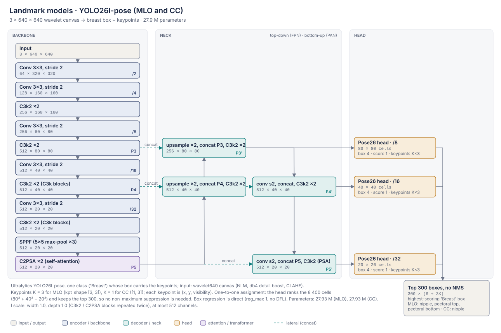
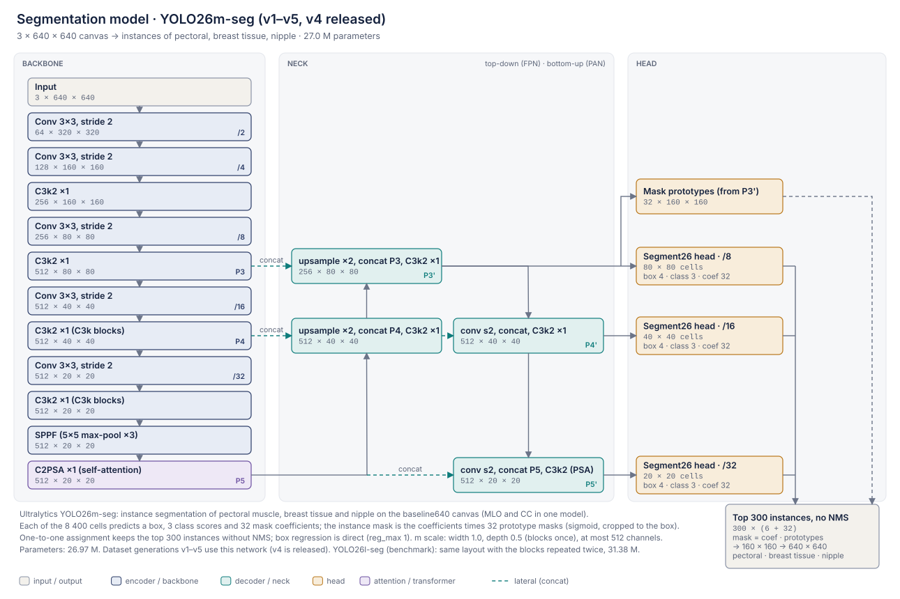
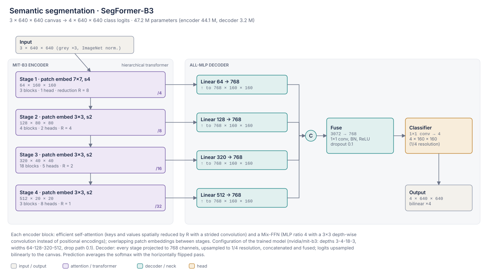
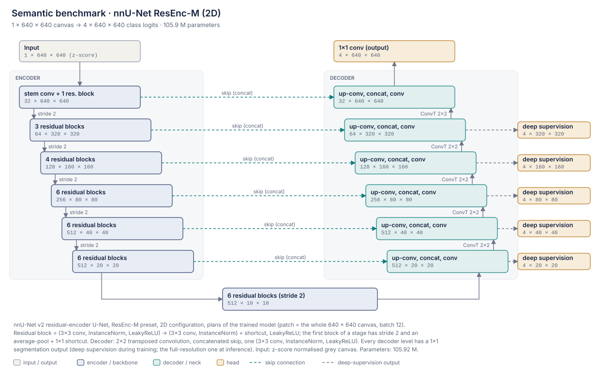
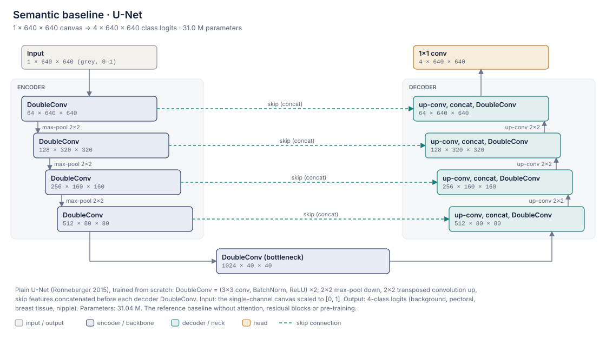
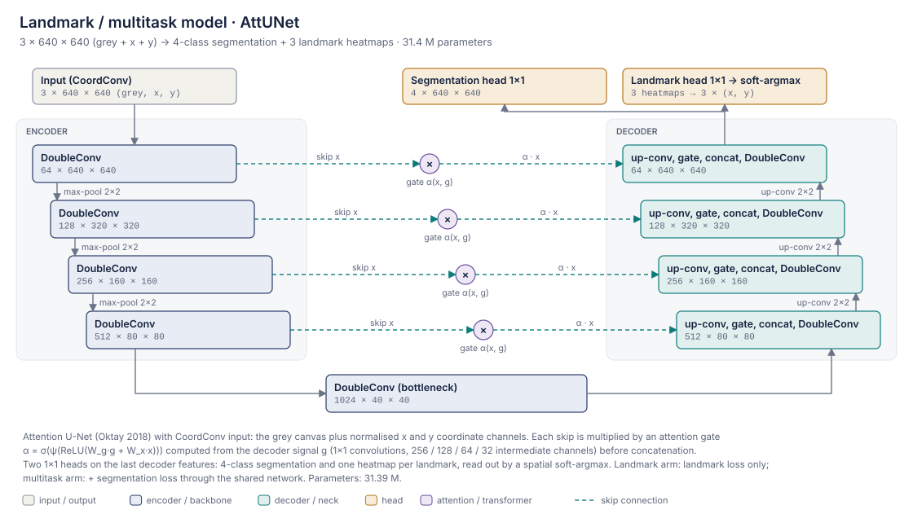
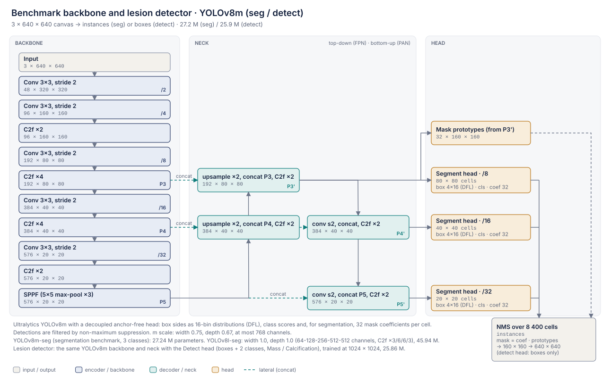
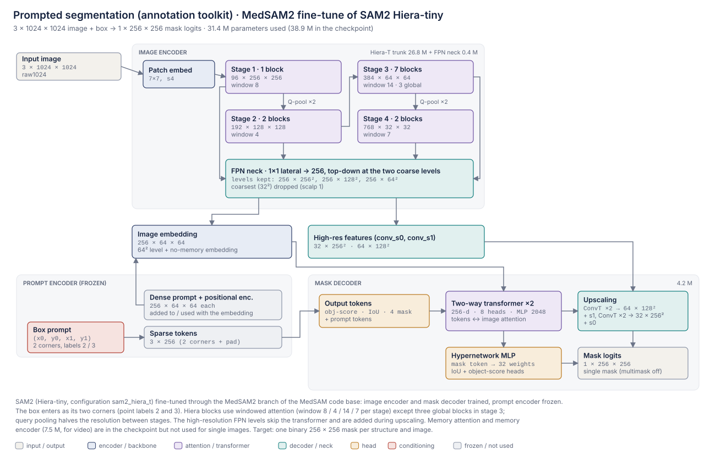

<p align="center"></p>

<h1 align="center">Mammography Segmentation &amp; Positioning</h1>

<p align="center">
  Breast tissue, pectoral muscle and nipple segmentation · MLO / CC landmark models · positioning assessment with the
  posterior nipple line (PNL) rule · a review web application · a configurable training framework · an annotation
  toolkit with MedSAM2
</p>

<p align="center">
  <a href="https://github.com/enescanerkan/mammography-segmentation-yolo/actions/workflows/ci.yml"></a>
  
  
  
</p>

<picture>
  <source media="(prefers-color-scheme: dark)" srcset="docs/figures/positioning_review_dark.png">
  
</picture>

<sub>Public CMMD images. Both measurement routes (landmark and segmentation) shown with their PNL / chest-wall
distances and the positioning criteria.</sub>

## What is in the repository

| Part | What it does | Where |
|---|---|---|
| **Positioning review app** | Upload a study (DICOM folder or files); the app segments each view, places the landmarks, measures the MLO posterior nipple line and the CC nipple-to-chest-wall distance, applies the ΔD rule, grades the positioning criteria and writes an EN / TR report. Labels can be corrected in the browser. | `breast_seg.apps.positioning` · [docs/APP.md](docs/APP.md) |
| **Inference engine** | One registry of models (`configs/models.yaml`), the preprocessing recipes they were trained with, and a landmark engine usable from Python. | `breast_seg.inference`, `breast_seg.registry`, `breast_seg.imaging` |
| **Positioning geometry** | PNL, chest-wall distance, criteria and scoring, independent of any model. | `breast_seg.geometry`, `breast_seg.positioning` |
| **Training** | One `Trainer` interface over YOLO-seg, YOLO-pose, YOLO-detect, SegFormer, nnU-Net, U-Net and AttUNet; YAML configs with inheritance and `--set` overrides; k-fold cross-validation. | `breast_seg.training` · [docs/TRAINING.md](docs/TRAINING.md) |
| **Datasets** | Builders that export one labelled pool to YOLO, semantic-mask and nnU-Net layouts with study-consistent, leak-checked splits. | `breast_seg.datasets` |
| **Evaluation** | Dice / IoU, landmark and distance errors in mm, the PNL decision rule, paired tests and bootstrap intervals, out-of-fold merging. | `breast_seg.evaluation` · [docs/EVALUATION.md](docs/EVALUATION.md) |
| **Annotation toolkit** | PyQt5 desktop app: MedSAM2 box / point prompting, manual polygon labelling with an optional detector, and a landmark-based positioning check. | `tools/annotation` · [README](tools/annotation/README.md) |

Every model with its layer architecture is shown under [Models](#models); training recipes and expected weight files
are listed in [docs/MODELS.md](docs/MODELS.md).

## The PNL rule in one paragraph

On the MLO view the posterior nipple line runs from the nipple perpendicular to the pectoral muscle edge; on the CC
view the matching distance runs from the nipple to the chest wall. For one breast,
`ΔD = |PNL(MLO) − D(CC)|`; a pair with `ΔD ≤ 10 mm` counts as adequately positioned (the threshold is a setting).
The app measures ΔD twice, from the pose landmarks and from the segmentation masks, and says when the two disagree.

## Quick start

### Windows app (no installation)

Download **`MammographyPositioning-windows-x64.zip`** from the
[latest build](https://github.com/enescanerkan/mammography-segmentation-yolo/releases/tag/dev-build), unzip it and run
`MammographyPositioning.exe`. The app opens in its own window, runs on the CPU, needs no internet connection and
contains the landmark and segmentation weights. It is rebuilt by GitHub Actions on every change to the app; tagged
versions are kept as separate releases. Details (where studies and settings are stored, building it yourself) in
[docs/APP.md](docs/APP.md#windows-desktop-app).

### 1. Weights

Weights are not part of the git history. The three the review app needs are published in the
[`weights-v1` release](https://github.com/enescanerkan/mammography-segmentation-yolo/releases/tag/weights-v1);
`python packaging/weights.py weights` downloads them into `weights/` and checks their SHA-256. The full layout, which
`--weights` / `$BREAST_SEG_WEIGHTS` may also point at:

```
weights/
  positioning/mlo-yolo26-pose-advanced.pt     MLO landmarks        (required)
  positioning/cc-yolo26-pose-advanced.pt      CC landmarks         (required)
  segmentation/breast_seg_v4_yolo26m.pt       segmentation         (required)
  detector/manual_detector.pt                 lesion detector      (optional, not published)
  medsam2/medsam_model_best.pth               MedSAM2 fine-tune    (annotation toolkit, not published)
  medsam2/sam2_hiera_tiny.pt                  SAM2 base            (annotation toolkit, from Meta's SAM2 release)
```

The annotation toolkit reads the same folder, so one copy serves both.

### 2a. Docker (CPU, no Python setup)

```bash
docker compose up --build            # http://localhost:8000
WEIGHTS_DIR=/path/to/weights docker compose up
```

The port is bound to this machine only; `POSITIONING_HOST=0.0.0.0 docker compose up` opens it to the network, which needs an
authenticated proxy in front (the app has no login). Studies are kept in the `positioning-data` volume. Uploaded DICOM files are never written to disk: only the
display renders and the label JSON are stored, and they expire after 30 days by default.

### 2b. Python

```bash
pip install -c constraints.txt -e ".[app,models,dicom]"   # CPU is enough; a CUDA build of torch is used when present
breast-seg models                             # every model with "weights found" / MISSING
breast-seg serve --device cpu                 # http://127.0.0.1:8000
breast-seg serve --host 0.0.0.0 --port 8077 --device 0 --weights /path/to/weights
```

`constraints.txt` pins the library versions the measurements were validated with (OpenCV, NumPy and Ultralytics
releases move ΔD by a few tenths of a millimetre); it applies to Python 3.9–3.11, the versions the Docker image and
CI use. Without it the package still installs, with the newest libraries.

Settings (threshold, retention, upload limits, criteria bands, interface language) live in an app config; copy
[`configs/app.example.yaml`](configs/app.example.yaml) and pass it with `--config`, or override single keys with
`--set rules.threshold_mm=12`.

### Using the models from Python

```python
from breast_seg.imaging import read_dicom
from breast_seg.inference import LandmarkEngine
from breast_seg.registry import Registry

engine = LandmarkEngine(Registry.load("configs/models.yaml"), device="cpu").load()
pixels, meta = read_dicom(open("L-MLO.dcm", "rb").read(), "L-MLO.dcm")
result = engine.analyse_landmarks(pixels, meta)   # nipple, pectoral line, masks as polygons, in original pixels
```

## Models

| Model | Used for | Architecture | Input → output | Parameters |
|---|---|---|---|---|
| Landmarks, MLO and CC | PNL landmarks in the app | YOLO26l-pose | wavelet640 canvas → breast box + keypoints (MLO 3, CC 1) | 27.9 M each |
| YOLO26m-seg v1–v5 (v4 in the app) | pectoral / breast tissue / nipple | YOLO26m-seg | baseline640 canvas → instances with masks | 27.0 M |
| SegFormer-B3 | semantic segmentation | MiT-B3 transformer + all-MLP decoder | 3 × 640 × 640 → 4 × 640 × 640 | 47.2 M |
| nnU-Net ResEnc-M | semantic segmentation | residual-encoder U-Net, 2D, 7 stages | 1 × 640 × 640 → 4 × 640 × 640 | 105.9 M |
| U-Net | semantic baseline | U-Net, 4 levels, from scratch | 1 × 640 × 640 → 4 × 640 × 640 | 31.0 M |
| AttUNet, landmark / multitask arm | landmarks with and without the segmentation signal | Attention U-Net + CoordConv, two heads | 3 × 640 × 640 → 4 classes + 3 heatmaps | 31.4 M |
| YOLO26l-seg, YOLOv8m-seg, YOLOv8l-seg | segmentation benchmark backbones | YOLO | canvas → instances with masks | 31.4 M, 27.2 M, 45.9 M |
| Lesion detector | box proposals in the annotation toolkit | YOLOv8m-detect | canvas → mass / calcification boxes | 25.9 M |
| MedSAM2 | box-prompted masks in the annotation toolkit | SAM2 Hiera-tiny, fine-tuned | 1024 × 1024 image + box → 256 × 256 mask | 31.4 M used |

Training recipes, datasets and weight files: [docs/MODELS.md](docs/MODELS.md). The figures below are drawn by
[`tools/figures/architectures.py`](tools/figures/architectures.py) from the models themselves: tensor shapes measured
with forward hooks on a 640 × 640 input (channels × height × width), parameter counts from the checkpoints and the
configurations of the trained models.

### Landmark models (YOLO26l-pose, MLO and CC)

<picture>
  <source media="(prefers-color-scheme: dark)" srcset="docs/figures/architectures/yolo26l_pose_dark.svg">
  
</picture>

<sub>Backbone, FPN/PAN neck and the NMS-free pose head; the best 'Breast' box carries the keypoints (MLO: nipple, pectoral top and bottom; CC: nipple).</sub>

### Segmentation model (YOLO26m-seg, dataset generations v1–v5)

<picture>
  <source media="(prefers-color-scheme: dark)" srcset="docs/figures/architectures/yolo26m_seg_dark.svg">
  
</picture>

<sub>Same backbone and neck at m scale; the head predicts per-cell boxes, classes and mask coefficients that weight 32 prototype masks.</sub>

### SegFormer-B3

<picture>
  <source media="(prefers-color-scheme: dark)" srcset="docs/figures/architectures/segformer_b3_dark.svg">
  
</picture>

<sub>Four-stage hierarchical transformer (efficient self-attention + Mix-FFN) and the all-MLP decoder that fuses every stage at 1/4 resolution.</sub>

### nnU-Net ResEnc-M (2D)

<picture>
  <source media="(prefers-color-scheme: dark)" srcset="docs/figures/architectures/nnunet_resenc_m_dark.svg">
  
</picture>

<sub>Seven-stage residual encoder, transposed-convolution decoder with concatenated skips and deep supervision, from the plans of the trained model.</sub>

### U-Net

<picture>
  <source media="(prefers-color-scheme: dark)" srcset="docs/figures/architectures/unet_dark.svg">
  
</picture>

<sub>The plain four-level U-Net trained from scratch, the reference without attention, residual blocks or pre-training.</sub>

### AttUNet (landmark and multitask arms)

<picture>
  <source media="(prefers-color-scheme: dark)" srcset="docs/figures/architectures/attunet_dark.svg">
  
</picture>

<sub>CoordConv input, attention-gated skips and two heads: segmentation and landmark heatmaps read out by a soft-argmax.</sub>

### YOLOv8m (segmentation benchmark, lesion detector)

<picture>
  <source media="(prefers-color-scheme: dark)" srcset="docs/figures/architectures/yolov8m_dark.svg">
  
</picture>

<sub>C2f backbone, decoupled DFL head and NMS; the lesion detector is the same network with a box-only head.</sub>

### MedSAM2 (annotation toolkit)

<picture>
  <source media="(prefers-color-scheme: dark)" srcset="docs/figures/architectures/medsam2_dark.svg">
  
</picture>

<sub>SAM2 Hiera-tiny image encoder, frozen prompt encoder for the box and the two-way-transformer mask decoder, fine-tuned for box-prompted masks.</sub>

## Training and evaluation

```bash
pip install -e ".[models,train]"                       # + ".[segformer]" / ".[nnunet]" for those families
cp configs/paths.example.yaml configs/paths.yaml       # machine paths live only here (git-ignored)

breast-seg build-dataset configs/datasets/seg_v5.yaml
breast-seg train configs/train/yolo26m_seg_v5.yaml --set device=0
breast-seg export configs/train/yolo26m_seg_v5.yaml          # copy the selected checkpoint to its release name
breast-seg cv configs/cv/cv10_yolo26m.yaml             # train, predict out-of-fold, merge, evaluate
breast-seg evaluate --config configs/cv/cv10_yolo26m.yaml --preds runs/preds --out results --name yolo26m
```

Training configs exist for every model family in the catalogue (`configs/train/`); cross-validation configs for
YOLO26m-seg, SegFormer-B3 and nnU-Net (`configs/cv/`). See [docs/TRAINING.md](docs/TRAINING.md).

## Annotation toolkit

```bash
pip install -e ".[annotation,models,dicom]"
python tools/annotation/app.py
```

Three modes behind one launcher: **SAM Label** (MedSAM2 box / point prompts, refine as polygons), **Manual Label**
(polygons and boxes, optional one-click detector) and **Breast Positioning** (landmarks on an MLO + CC pair with a
live PNL / chest-wall overlay). Labels are saved in YOLO segmentation format. Details in
[tools/annotation/README.md](tools/annotation/README.md).

## Repository layout

```
src/breast_seg/
  apps/positioning/     review web application (FastAPI + build-free client)
  inference/            landmark engine, lazy model loading
  imaging/              DICOM reading, preprocessing recipes, display renders
  positioning/          measures, criteria, scoring, reports
  training/             trainers per model family, k-fold runner
  datasets/             dataset builders and exporters, split checks
  evaluation/           metrics, PNL rule, statistics
  compare/              ground truth vs landmarks vs segmentation on a labelled set
  geometry.py           PNL and chest-wall geometry
  registry.py           model registry
  cli.py                the breast-seg command
configs/                models.yaml, app example, train / datasets / cv configs, paths example
packaging/              Windows desktop build (PyInstaller spec, launcher) and the weights manifest
tools/annotation/       PyQt5 annotation toolkit (MedSAM2, manual, positioning)
docs/                   APP, MODELS, TRAINING, EVALUATION; figures/architectures (model diagrams)
tools/figures/          the script that draws the architecture figures
tests/                  unit and API tests (CPU, no weights needed)
```

## Development

```bash
pip install -c constraints.txt -e ".[app,models,dicom,train,dev]"
pytest                                              # package tests
QT_QPA_PLATFORM=offscreen pytest tools/annotation/tests
ruff check src tests tools
```

Tests that need the real weights are marked `weights` and skip themselves when the files are absent.

## Notes

Research software, not a medical device: every measurement must be checked by a reader. The interface is English
by default with a Turkish switch.

## License

MIT, see [LICENSE](LICENSE). The vendored [Tabler](https://tabler.io) stylesheet is MIT-licensed as well.
